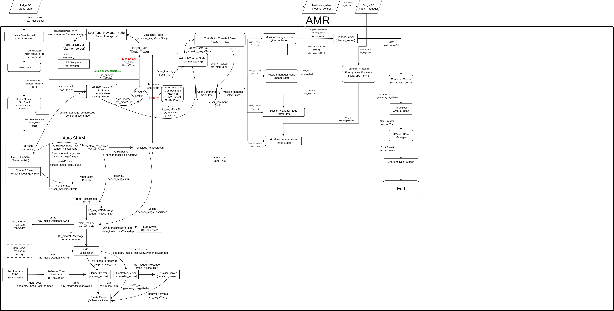

# Autonomous Patrol Robot (SOCAMACA)

A TurtleBot 4 that starts with no map, explores and maps an arena on its own, stops when its camera finds a camouflaged opponent robot, turns to aim at it, and fires a ping-pong ball only after a human approves the shot in a web UI. Built as a two-team wargame with a separate judge system that scores hits.

ROKEY Robotics Bootcamp team project, July 2026. Built and demonstrated on hardware.

```
ROS 2 Humble · Nav2 · SLAM · explore_lite · TurtleBot 4 (namespace /robot4) · YOLO · React + FastAPI
```

> Korean setup guide: [SETUP.ko.md](SETUP.ko.md). Some folder READMEs and code comments are in Korean.

## Team

| Member | Role |
|---|---|
| Duyong Kim | PM, system design, data augmentation |
| Hyunho Shin | Monitoring, hit detection, integration |
| **Gene Woo Lim** | Autonomous driving (SLAM, Nav2, patrol behavior), robot state management |
| Jihyeok Cho | Autonomous driving, robot state management |
| Seungeon Bu | Detection algorithm, IFF communication |
| Yongjun Jeong | Launcher hardware, monitoring, integration |
| Hoseong Park | Detection algorithm, data augmentation |

My part: SLAM, Nav2 and the patrol behavior, everything that moves the robot when it is not aiming.

## System design



Design diagram from the planning stage (editable source: `docs/system_design.drawio`). It shows the operator-command version of the state machine; the final code switches states automatically from HP and detection, as described below.

## What the system does

1. **Patrol.** The robot undocks, runs SLAM and `explore_lite`, and drives toward unexplored frontiers while building the map.
2. **Detect.** A YOLO model on the camera image finds the camouflaged opponent and publishes a bearing on `aim/set_ori`.
3. **Aim.** The mission manager pauses exploration and hands the wheels to the aiming controller, which rotates the robot until the target is centered.
4. **Approve and fire.** The team UI shows the camera view; the operator clicks to approve, and the Arduino launcher fires.
5. **Cooldown, track, return.** After a shot the robot ignores the target for 15 s and keeps patrolling. If the opponent has 1 HP left, it drives toward the last known position. If either robot reaches 0 HP, it returns home.

| State | What drives the wheels | Leaves when |
|---|---|---|
| PATROL | `explore_lite` → Nav2 (speed limit 70%) | bearing received on `aim/set_ori` |
| WAIT_COMMAND | `azimuth_tracker` (rotation only) | shot completed, or target lost for 5 s |
| COOLDOWN | `explore_lite` → Nav2 | 15 s passed, or opponent HP = 1 |
| TRACK | `target_nav` | approach finished |
| RETURN | Nav2 goal to the start pose | home |

## The problem I spent the most time on

### Two controllers wanted the same wheels
`explore_lite` drives through Nav2, but the aiming controller publishes straight to `cmd_vel`. When both were active, the robot jerked between a frontier goal and the target bearing.

The fix is a gate, not arbitration: in every state exactly one node owns `cmd_vel` (table above). Each node subscribes to `robot_mode` and acts only in its own states. `robot_mode` is published with TRANSIENT_LOCAL QoS so a node that starts late still gets the current state.

Pausing exploration was not enough by itself: a Nav2 goal already running kept executing, so the robot kept rolling toward a frontier while trying to aim. The state change also has to cancel the active goal.

### Getting stuck
In a small arena, frontier exploration drives the robot into corners and stops once the map is done. `random_patrol.py` watches odometry in PATROL: if the robot moves less than 0.3 m in 20 s, it pauses `explore_lite`, shuffles a set of fixed patrol poses, and drives them with one `NavigateThroughPoses` action, repeating while the robot is in PATROL. It cancels immediately when the state changes.

Most tuning time went into the local costmap and the inflation radius: too large and narrow gaps were no longer passable, too small and the robot clipped obstacles while turning.

### The cooldown
After a shot, the same target was detected again at once and the robot locked up in place. The 15 s cooldown also moves the robot away from the spot. Because it is time-based, it works even though `aim/set_ori` carries only a bearing and no target identity.

## Design notes

- **The bearing is normalized, not radians.** `aim/set_ori` is 0.0 at the frame center, negative left, positive right. The aiming deadband of 0.05 means "within 5% of the frame width". Agreeing on this unit between perception and control mattered more than the control law.
- **All topic names are relative.** The same nodes run on any robot with `--ros-args -r __ns:=/robot4`.
- **States are an `Enum`, not strings,** so a typo fails loudly instead of silently skipping a transition.
- **`shoot_complete` is an event, not a value.** Receiving it means the shooter finished; the result is not inspected.

## Repository layout

```
AMR_ws/tracking/          mission_manager.py (state machine), random_patrol.py,
                          azimuth_tracker.py (aiming), target_nav.py (TRACK approach)
mission_manager_pkg/      earlier refactor of the state machine: one file per state,
                          shared blackboard for all topic I/O, tests without ROS
patrol_ws/src/            socamaca_msgs (custom messages), yolo_detector (YOLO node)
arduino_shooter/          ROS 2 node for the ping-pong launcher
socamaca-ui/              team UI and judge UI (React), FastAPI backend, judge vision
cod/                      ball tracking and hit detection experiments
start_all.sh, stop_all.sh start and stop the whole pipeline
```

Model weights (`*.pt`), datasets, and build folders are not included.

## Running

See [SETUP.ko.md](SETUP.ko.md) for the full setup. In short:

```bash
# Build messages, detector and state machine
cd patrol_ws && colcon build --symlink-install && source install/setup.bash
cd ../AMR_ws && colcon build --symlink-install --packages-select tracking && source install/setup.bash

# Front ends
cd socamaca-ui/frontend-team-pc && npm install    # copy .env.example to .env

# Start everything (robot SSH login comes from the environment)
export ROBOT_SSH=ubuntu@<robot-ip> ROBOT_PASS=<password>
./start_all.sh
```

Requires the standard TurtleBot 4 workspace (SLAM and Nav2 launch files), `m-explore-ros2` (explore_lite) built in `AMR_ws/src/`, and `ros-humble-rosbridge-server`.

## What I would do differently

- Decide which node owns `cmd_vel` at the start. The conflict showed up late, after both controllers already worked alone.
- Connect all nodes end to end early with stubs, so interface disagreements show up in week one.
- Log the bearing together with the state; most confusing failures were "why did it leave WAITING?".
